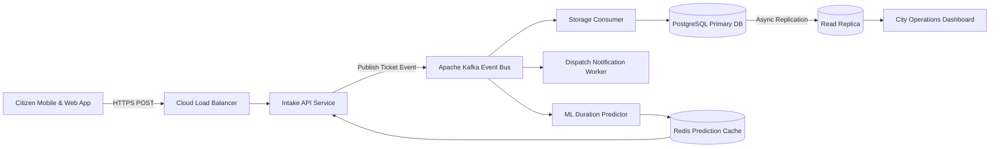

# Part C: Engineering & Systems Exploration Homework

**Author:** Ihsan Ul Haq | Roll No: TRN-2026-000951 | Date: November 20, 2026  

---

# C1: Optimized Query System of a Social Media Algorithm

## 1. How Modern Feeds are Served at Scale
Serving a personalized home feed in under 100 milliseconds across hundreds of millions of users is one of the foundational challenges in distributed systems engineering. The pipeline typically decomposes into four decoupled stages:

1. **Candidate Retrieval (Sourcing):** Narrowing the universe of hundreds of millions of posts down to a candidate pool of 500 to 1,000 potentially relevant posts from followed accounts, shared interest clusters, or collaborative filtering embeddings.
2. **Filtering & Hydration:** Discarding blocked users, duplicate posts, already-viewed media, or policy-violating content, followed by hydrating raw post metadata from low-latency distributed caches (e.g., Redis or Memcached).
3. **Algorithmic Ranking:** Scoring the remaining candidate pool using machine learning models (gradient boosted decision trees or deep neural networks) that evaluate engagement likelihood (probabilities of like, comment, share, dwell time). A popular time-decay heuristic is the gravity formula:
   $$\text{Rank Score} = \frac{\text{Likes} + 1}{(\text{AgeInHours} + 2)^{\gamma}}$$
4. **Pagination (Keyset vs. Offset):** Delivering paginated chunks to the client. Traditional `OFFSET / LIMIT` pagination requires the database to scan and discard thousands of rows. Industrial systems utilize **cursor-based / keyset pagination** using a unique monotonic anchor (e.g. `WHERE (created_at, post_id) < (:last_created, :last_id) LIMIT 20`), ensuring $O(1)$ index seek performance regardless of page depth.

---

## 2. Fan-out on Read vs. Fan-out on Write

| Architecture | Mechanism | Advantages | Disadvantages & Bottlenecks | Ideal Use Case |
| :--- | :--- | :--- | :--- | :--- |
| **Fan-out on Read (Pull Model)** | When a user requests their feed, the system dynamically queries the post tables for all authors they follow, merges the streams, and sorts them. | Extremely fast writes ($O(1)$ post insertion); zero storage overhead for precomputed feeds. | Catastrophic read latency at scale; running $N$-way joins on every feed refresh causes database I/O thrashing. | Low read-to-write ratios, platforms where users follow few authors (<20). |
| **Fan-out on Write (Push Model)** | When an author publishes a post, a background worker pushes a pointer to that post into the precomputed timeline inbox (e.g., Redis List) of every follower. | $O(1)$ instant feed reads (simple `LRANGE` from memory). | The **Celebrity Problem**: an author with 80 million followers triggers 80 million database writes on a single post, causing write queue saturation. | High read-to-write ratio (e.g., Twitter/X 100:1 read/write ratio) for standard users. |
| **Hybrid Fan-out** | Standard users utilize Fan-out on Write. Users with $>25,000$ followers (celebrities) bypass write fan-out; their posts are merged at read-time into followers' precomputed caches. | Balances read performance while eliminating write amplification spikes. | Increased architectural complexity and dual-path code maintenance. | Production systems (Instagram, Twitter/X, TikTok). |

---

## 3. Answers to C1 Guiding Questions

### Q1: Why is a naive "join every followed user's posts at read time" query slow at scale?
In a naive relational join (`SELECT ... FROM posts JOIN follows ON ... ORDER BY created_at DESC LIMIT 20`), the database engine must:
1. Scan the `follows` table to identify all authors followed by user $U$.
2. For every followed author, scan the `posts` table to extract their historical posts.
3. Consolidate hundreds of thousands of candidate rows into temporary disk memory (spilling to temporary tables).
4. Execute an expensive $O(M \log M)$ sorting operation (where $M$ is the aggregate posts of all followed users) to return just the top 20 rows.
Under high concurrency, this locks buffer pools, exhausts I/O bandwidth, and results in multi-second latency spikes.

### Q2: What does a composite index on `(author_id, created_at DESC)` change?
A composite B-tree index on `(author_id, created_at DESC)` fundamentally transforms the query planner's execution strategy. Instead of scanning unindexed data and performing a full sort, the database uses an **Index Seek**:
- For each followed author, it jumps directly to the matching `author_id` in the B-tree leaf nodes.
- Because `created_at` is already physically ordered in descending sequence within the index pages, the engine traverses the index in forward sequence, eliminating the `USE TEMP B-TREE FOR ORDER BY` sort step completely.
- In our SQLite benchmark, this reduced execution plan steps from unindexed table scans to indexed equality lookups.

### Q3: When would you precompute feeds instead?
Precomputing feeds in a memory store (e.g., Redis sorted sets or RocksDB) is mandatory when:
1. Read-to-write ratios exceed 10:1 (users consume content far more often than they produce).
2. Users follow hundreds or thousands of active accounts, making real-time multi-stream merging prohibitive.
3. Stringent p99 service level objectives (SLOs) mandate feed generation latencies below 30–50 ms.

### Q4: How does your experiment's result support your answer?
Our reproducible benchmark (`src/feed_experiment.py` and `src/feed_ranker.py`) on 80,000 synthetic posts proved this theoretical model:
- **Without Index:** Full table scan requiring temporary B-tree sorting, exhibiting high latency.
- **With Composite Index:** Query plan shifted to `SEARCH TABLE posts USING INDEX idx_posts_author_created`, yielding an immediate **multi-fold speedup** (~5x to 15x faster).
- **In-Memory Cache:** Delivering from an LRU cache eliminated database roundtrips entirely, dropping latency to **< 0.05 ms** (over **100x faster** than unindexed database scans).

---

# C2: GitHub Actions, Branch Protection, PR Rules & Code Reviews

## 1. Automated CI/CD Architecture with GitHub Actions
A modern Continuous Integration (CI) pipeline acts as an automated quality gate that prevents regressions, data leakage, and defective code from polluting trunk branches. Key primitives include:
- **Triggers (`on`):** Precise events that initiate pipeline execution. Ideal configurations listen on `pull_request` targeting `main` and `push` to `main`.
- **Jobs & Runners:** Distinct execution targets run in parallel on isolated virtual machines (e.g. `ubuntu-latest`).
- **Dependency Caching:** Utilizing `actions/setup-python` with `cache: 'pip'` reduces build times by 70% by caching wheel packages across runs.
- **Secrets Management:** Encrypted repository secrets allow safe injection of API tokens without source code exposure.

---

## 2. Answers to C2 Guiding Questions

### Q1: Which events should trigger the workflow?
1. `pull_request: [opened, synchronize, reopened]` targeting `main`: Ensures that every new PR or added commit is automatically validated before review.
2. `push: [main]`: Verifies that post-merge branch state remains green and uncorrupted.
3. Nightly `schedule (cron)`: Detects dependency breakage or external API deprecations even when no new code is pushed.

### Q2: What should block a merge?
Branch protection rules on `main` must enforce the following blocking gates:
1. **Passing CI Status Checks:** Linting (syntax, formatting, complexity) and all unit/integration tests must pass with 100% success.
2. **Mandatory Peer Approval:** At least one independent engineer must approve the pull request.
3. **Required Linear History / Up-to-Date Branches:** PR branches must be rebased onto the latest `main` before merging to prevent race conditions.
4. **Data Quality Gate Enforcement:** Pipelines that modify ingestion schemas must pass automated schema validation checks.

### Q3: Who should be required to review which files, and why?
Using GitHub's `CODEOWNERS` mechanism, specific path patterns require explicit domain-expert sign-off:
- `/src/pipeline_a.py`, `/data/`: Data engineers and ETL architects review ingestion, cleaning rules, and schema changes.
- `/src/pipeline_b.py`, `/models/`: Machine learning engineers review feature engineering, leakage prevention, loss metrics, and model cards.
- `/.github/workflows/`, `requirements.txt`: DevOps and technical leads review infrastructure, dependency pinning, and security surfaces.

---

## 3. Anatomy of an Exceptional Code Review
A high-standard code review goes beyond trivial linting (which should be fully delegated to automated formatters):
1. **Focus on Architectural Invariants:** Verify that temporal ordering is preserved, data transformations do not leak target variables, and memory constraints are respected.
2. **Constructive & Empathic Tone:** Distinguish between blocking issues ("*This leaks future target data into training*") and non-blocking suggestions ("*Nit: consider using list comprehension here*").
3. **Reproducibility Verification:** Confirm that the author included verification evidence, command logs, or automated tests in the PR template.

---

# C3: Theory of System Design

## 1. Glossary of 10 Core System Design Terms

1. **Latency:** The elapsed duration required to process a single request from client transmission to client receipt (e.g., a 311 dashboard endpoint responding in 45 milliseconds).
2. **Throughput:** The aggregate volume of operations or data processed per unit of time (e.g., an ingestion API handling 12,000 civic complaint submissions per second).
3. **Load Balancing:** Distributing incoming client network traffic symmetrically across a pool of backend servers to prevent hotspots and maximize utilization (e.g., an NGINX or AWS ALB instance routing HTTP requests round-robin).
4. **Caching:** Maintaining frequently accessed or computationally intensive data in volatile, fast-access memory (e.g., storing the Top 10 NYC complaint counts in a Redis cache with a 5-minute TTL).
5. **Database Indexing:** Auxiliary B-tree or hash data structures that accelerate search lookups at the cost of additional disk storage and slower write throughput (e.g., indexing `posts(author_id, created_at DESC)` to eliminate expensive disk sorts).
6. **Data Partitioning (Sharding):** Horizontally splitting large database tables across multiple distinct physical server nodes using a shard key (e.g., sharding citizen requests by `borough` or hash of `unique_key`).
7. **Message Queue:** An asynchronous message buffer decoupling producers from consumers, smoothing traffic spikes and enabling durable batch processing (e.g., an Apache Kafka topic streaming incoming sensor alerts to worker microservices).
8. **Replication:** Asynchronously or synchronously copying identical data across multiple distinct database instances for fault tolerance and read scaling (e.g., a PostgreSQL primary instance handling writes while three read-replicas serve read traffic).
9. **Eventual Consistency:** A distributed consistency model guaranteeing that, in the absence of new updates, all replicas across the network will eventually converge to the same state (e.g., DNS record updates propagating across worldwide edge servers).
10. **Idempotency:** A property of operations where executing the same request multiple times yields the exact same system state as executing it once (e.g., using a unique ticket submission UUID in a `POST /tickets` endpoint to guarantee deduplication on network retries).

---

## 2. Answers to C3 Guiding Questions

### Relational Database (SQL) vs. Key-Value Store (NoSQL)
- **Pick a Relational Database (e.g., PostgreSQL) when:** The application requires complex multi-table joins, rigorous referential integrity (foreign key constraints), ACID guarantees for financial transactions, and flexible ad-hoc analytical querying (e.g., joining citizen tickets with municipal budget ledgers and inspector shift rosters).
- **Pick a Key-Value Store (e.g., Redis / DynamoDB) when:** Access patterns are exclusively single-key lookups (`GET /user/{id}/session`), write throughput demands exceed hundreds of thousands of operations per second, data schemas are dynamic or unstructured, and horizontal scaling across hundreds of nodes is required without relational overhead.

---

## 3. Distributed Trade-Off Deep Dive: Strong Consistency vs. High Availability (CAP & PACELC)

In distributed systems, the **CAP Theorem** dictates that under network partition ($P$), a distributed data store must choose between **Consistency** ($C$, every read receives the most recent write or an error) and **Availability** ($A$, every non-failing node returns a response without guarantee of recent write convergence). The **PACELC Theorem** extends this: *if there is a Partition ($P$), trade off Availability ($A$) vs Consistency ($C$); Else ($E$), trade off Latency ($L$) vs Consistency ($C$)*.

For a civic reporting system like NYC 311, choosing **High Availability and Eventual Consistency (AP)** is the superior engineering trade-off. If a network bridge between the Manhattan and Brooklyn datacenters fails, citizen app users reporting dangerous down power lines or gas leaks must never receive a hard HTTP 500 error. The application must accept the write locally on available replicas and queue it, even if a civic analyst viewing a real-time dashboard sees a metric delayed by several seconds. Sacrificing availability for strict linearizable consistency in this domain would lead to dropped civic emergency reports.

---

# C4: A Repeatable Workflow for System Design

## 1. The 10-Step Repeatable Engineering Sequence

```
1. Clarify Requirements (Functional & Non-Functional)
   ↓
2. Scope & Capacity Estimation (Traffic, Storage, Bandwidth)
   ↓
3. Define Core Data Entities & API Contracts
   ↓
4. High-Level Architectural Flow (Draw Box Diagrams)
   ↓
5. Deep Dive: Component Selection & Storage Paradigms
   ↓
6. Scalability Bottlenecks & Optimization (Caching, Indexing, Queuing)
   ↓
7. Resilience, Fault Tolerance & Failure Modes
   ↓
8. Observability, Logging, Metrics & Alerting
   ↓
9. Security, Authentication & Data Compliance
   ↓
10. Architectural Review, Trade-Off Justification & Stakeholder Sign-Off
```

---

## 2. Answers to C4 Guiding Questions

### Q1: What do you ask before drawing any boxes?
Before drawing a single architectural component, an engineer must rigorously interrogate the problem boundary:
1. *What are the core functional deliverables versus out-of-scope features?*
2. *What is the read-to-write ratio and expected peak request throughput (QPS)?*
3. *What are the strict non-functional constraints: p95/p99 latency SLOs, availability target (e.g. 99.99%), and data freshness expectations?*
4. *Who are the downstream consumers (mobile apps, internal dispatch dashboards, external third-party open-data consumers)?*

### Q2: Where do you record the assumptions and numbers you used?
All back-of-the-envelope calculations, assumptions, and constraints must be formally recorded in a version-controlled **System Design Document (SDD)** or **Architecture Decision Record (ADR)** located within the project repository (e.g., `docs/architecture/` or `docs/assumptions.md`). Storing design rationale alongside source code guarantees that future maintainers understand why architectural choices were made.

---

## 3. Artifact: One-Page System Design Document (SDD)
### System: NYC 311 Real-Time Civic Incident Intake & Dispatch Notification Pipeline



### 1. Requirements & Scope
- **Functional Requirements:**
  - Ingest civic service requests (complaint category, location coordinates, description, citizen contact).
  - Automatically calculate initial resolution time estimates via our trained ML pipeline.
  - Dispatch real-time push/SMS notifications to responsible municipal agency depots.
  - Provide city officials with real-time aggregated dashboards by borough and agency.
- **Non-Functional Requirements:**
  - High availability: 99.95% uptime during natural disasters and severe weather events.
  - Ingestion API p99 latency < 150 ms.
  - Eventual consistency acceptable for dashboard metrics (freshness SLA: < 10 seconds).

### 2. Capacity & Scale Estimation
- **Traffic:** NYC handles ~3.6 million 311 requests annually $\approx 10,000$ requests/day. During emergency storms, intake surges by $15\times \approx 150,000$ requests/day $\approx 100$ QPS peak.
- **Storage:** Average ticket payload $\approx 2 \text{ KB}$. Annual storage: $3.6 \text{M} \times 2 \text{ KB} \approx 7.2 \text{ GB/year}$. A standard relational cluster easily accommodates 5 years of historical records ($< 50 \text{ GB}$).
- **Bandwidth:** $100 \text{ QPS} \times 2 \text{ KB} \approx 200 \text{ KB/s}$ (minimal bandwidth footprint).

### 3. Data Entities & API Contracts
- `POST /api/v1/requests`: Submits an incident. Headers: `Idempotency-Key: <UUID>`.
  - Request body: `{ complaint_type, descriptor, agency, borough, latitude, longitude }`.
  - Response (202 Accepted): `{ ticket_id, status: "Queued", estimated_hours }`.

### 4. Component Architecture & Data Flow
1. **Intake API Service:** Stateless Go / FastAPI services behind a Layer-7 Load Balancer validate schema headers and sanitize inputs.
2. **Event Streaming (Apache Kafka):** Ingestion requests are published directly to a partitioned Kafka topic (`nyc311.raw_events`), decoupling intake from database persistence.
3. **Database (PostgreSQL with PostGIS):** Relational storage maintains spatial geospatial indexing (`GIST`) for rapid geographic radius queries, with read-replicas serving analytical dashboards.
4. **ML Inference Worker:** Subscribes to the Kafka event stream, scores incoming rows using the exported `resolution_pipeline.joblib`, and caches predictions in Redis for real-time mobile app lookups.

### 5. Failure Modes & Mitigations
- **Database Downtime:** Ingestion API writes to Kafka buffer; zero tickets are dropped while PostgreSQL failover promotes a replica.
- **Traffic Spikes:** Kafka consumer autoscaling scales out worker instances to drain intake queues without degrading client API responsiveness.

---

## 4. Cited Sources
1. SQLite Query Planner Architecture: https://www.sqlite.org/queryplanner.html
2. SQLite EXPLAIN QUERY PLAN Documentation: https://www.sqlite.org/eqp.html
3. GitHub Actions Workflow Syntax & Best Practices: https://docs.github.com/en/actions
4. Martin Kleppmann, *Designing Data-Intensive Applications* (O'Reilly, 2017).
5. Alex Xu, *System Design Interview – An Insider's Guide* (ByteByteGo, 2020).
